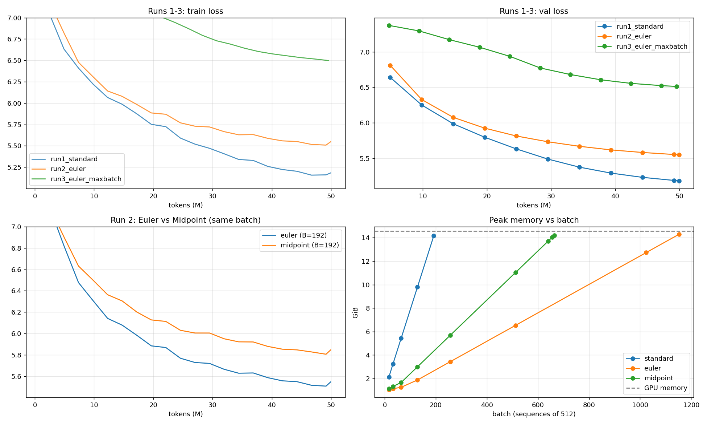

# Session 13 — Reversible Training of a 20M LLM on 50M Tokens

Training the same ~21M-parameter GPT three ways on a single free-tier **Tesla T4 (14.6 GiB)** in Google Colab:

1. **Run 1:** a standard transformer at a fixed batch, the largest the standard model can fit.
2. **Run 2:** a **reversible** transformer at the same batch, testing two variants from Gal et al. (2025), **Euler** and **Midpoint**.
3. **Run 3:** the winning reversible variant at its **maximum batch size**.

Notebook: [`S13_reversible_training.ipynb`](S13_reversible_training.ipynb) (all outputs included) · Raw results: [`results/`](results/)

---

## TL;DR

| | Run 1: Standard | Run 2: Reversible Euler | Run 2: Reversible Midpoint | Run 3: Reversible Euler, max batch |
|---|---|---|---|---|
| Batch (sequences × 512 tokens) | 192 | 192 | 192 | **1,152** |
| Tokens per step | 98,304 | 98,304 | 98,304 | 589,824 |
| Optimizer steps (50M tokens) | 508 | 508 | 508 | 84 |
| Peak LR | 1.0e-3 | 1.0e-3 | 1.0e-3 | 2.45e-3 |
| **Final val loss** | **5.186** | 5.555 | 5.847 | 6.513 |
| Final train loss | 5.185 | 5.536 | 5.837 | 6.535 |
| **Speed (tokens/s)** | **54,937** | 43,967 (−20%) | 42,445 (−23%) | 42,834 (−22%) |
| **Peak memory (allocated)** | 14.17 GiB | **2.65 GiB (5.3× less)** | 4.34 GiB (3.3× less) | 14.29 GiB |
| Peak memory (reserved) | 14.40 GiB | 2.85 GiB | 4.45 GiB | 14.36 GiB |
| Training time | 14.9 min | 18.6 min | 19.2 min | 18.4 min |
| Est. cost per 50M tokens* | $0.088 | $0.111 | $0.115 | $0.113 |

\* Colab's free tier costs nothing; this assumes a cloud T4 at $0.35/hour.

**Maximum batch that fits on the T4** (a full forward, backward and AdamW step):

| Model | Max batch | Activation memory per 512-token sequence | vs standard |
|---|---|---|---|
| Standard | 192 | 70.1 MiB | 1.00× |
| Reversible Midpoint | 664 | 21.0 MiB | 3.46× |
| **Reversible Euler** | **1,152** | **12.1 MiB** | **6.00×** |

**The variant that worked for me was Euler (the Hamiltonian / symplectic-Euler coupling).** At the same batch it beat Midpoint on val loss at every checkpoint (5.555 vs 5.847 at 50M tokens), and it needed 39% less memory.



---

## 1. Assignment

> Train a 20M LLM for 50M tokens on Google Colab. Fix the batch size that you can run. Train again with Reversibility (report which variant worked for you: midpoint, Euler, etc). Train again with Reversibility, but push it to the maximum batch size. Report final loss, speed (tokens/s), memory peak and other findings.

Clarifications from class, which I followed:

- The fixed batch is the **largest batch the standard model can run**.
- Test **both Euler and Midpoint**.
- Reversibility requires **no dropout** and **no weight decay**. I applied this to every run so the only difference between runs is the residual rule.

## 2. Setup

| | |
|---|---|
| Hardware | Google Colab, Tesla T4 (14.6 GiB), fp16 autocast + GradScaler, PyTorch 2.11 |
| Data | FineWeb-Edu (`sample-10BT`, streamed): 50.23M training tokens + 1.0M held-out validation tokens |
| Tokenizer | Byte-level BPE, **8,192 tokens**, trained on about 60 MB of the same stream (≈4.11 characters per token). A 50k GPT-2 vocabulary would put ~19M of the 20M parameters into the embedding table. |
| Model | GPT with pre-LayerNorm, d_model 384, **10 layers**, 6 heads, MLP 4×, sequence length 512, tied embeddings. **21.05M parameters** (17.71M non-embedding). |
| Optimizer | AdamW (β 0.9/0.95), weight decay 0, gradient clip 1.0, warmup 2% then cosine to 10% |
| Regularization | Dropout 0, weight decay 0 (reversibility constraint, applied to all runs) |
| Data order | One fixed shuffled order of non-overlapping 512-token windows, identical for every run; each run sees each token once |
| LM head | Cross-entropy computed in 8k-token chunks with checkpointing, in **all** runs, so the logits don't mask the activation savings |
| Measurement | tokens/s = tokens ÷ time spent on optimizer steps (first 10 steps and eval time excluded). Peak memory = `torch.cuda.max_memory_allocated()`. Val loss on a fixed 327k-token held-out set. |

## 3. Reversible variants

All variants use **exactly the same parameters** as the standard model: the same attention, MLP and LayerNorms per layer. Only the rule that combines layer outputs changes.

| Variant | Update per layer | How the backward pass rebuilds the input |
|---|---|---|
| Standard (not reversible) | $p^{\ell+1} = p^{\ell} + f_\ell(p^{\ell})$ | — (autograd stores every layer's activations) |
| **Midpoint** (paper eq. 2.4) | $p^{\ell+1} = p^{\ell-1} + 2h\,f_\ell(p^{\ell})$, with $h = 0.25$ | $p^{\ell-1} = p^{\ell+1} - 2h\,f_\ell(p^{\ell})$ |
| **Euler** (paper eqs. 2.8–2.9, Hamiltonian) | $q^{\ell} = q^{\ell-1} + \mathrm{Attn}_\ell(\mathrm{LN}_1(p^{\ell-1}))$, then $p^{\ell} = p^{\ell-1} + \mathrm{MLP}_\ell(\mathrm{LN}_2(q^{\ell}))$ | $p^{\ell-1} = p^{\ell} - \mathrm{MLP}_\ell(\mathrm{LN}_2(q^{\ell}))$, then $q^{\ell-1} = q^{\ell} - \mathrm{Attn}_\ell(\mathrm{LN}_1(p^{\ell-1}))$ |

Here $f_\ell(x) = a + \mathrm{MLP}(\mathrm{LN}_2(x + a))$ with $a = \mathrm{Attn}(\mathrm{LN}_1(x))$, the usual pre-LN block written as a residual update.

- **Midpoint** starts with one ordinary step, $p^1 = p^0 + h\,f_0(p^0)$. Only that first layer's activations are stored.
- **Euler** starts with $q^0 = p^0 = $ the embedding, and the output is $(q^L + p^L)/2$. The paper calls this model the Hamiltonian architecture and describes it as *"a staggered update scheme resembling the symplectic Euler integrator"*, so it is the "Euler" variant.

**Implementation.** Each reversible stack is a custom `torch.autograd.Function`:

- The **forward pass** runs without building a graph and saves only the top states: $(p^{L-1}, p^L)$ for Midpoint, $(q^L, p^L)$ for Euler.
- The **backward pass** walks down the layers. For each layer it rebuilds that layer's input with the inverse formula, re-runs that one layer with autograd on, and backpropagates through it. It then frees that layer and moves to the next.
- The residual stream is kept in fp32; blocks run under fp16 autocast.

**Correctness checks** (run before any training):

| Test | Euler | Midpoint |
|---|---|---|
| Gradient of the reversible backward vs plain autograd, float64, tiny model | 0.0 (exact) | 0.0 (exact) |
| Same comparison, fp32 on the GPU, real model | 8.7e-6 | 1.7e-6 |
| Same comparison, fp16 autocast | 7.9e-3 | 1.3e-2 |
| Relative error of the rebuilt input, at initialization | 8.7e-4 / 2.3e-3 (q / p) | 1.0e-3 / 8.1e-4 |

The backward pass is mathematically exact. What remains in fp16 is rounding.

## 4. Results

### Run 1: Standard, batch 192 (the largest the standard model fits)

- **Final val loss 5.186**, 54.9k tokens/s, **peak 14.17 GiB** of the T4's 14.6 GiB.
- Batch 200 ran out of memory. Memory grows by **70.1 MiB per extra 512-token sequence**: about 7 MiB per layer per sequence, times 10 layers.

### Run 2: Reversible at the same batch (192), Euler vs Midpoint

| | Euler | Midpoint |
|---|---|---|
| Final val loss | **5.555** | 5.847 |
| Tokens/s | **43,967** | 42,445 |
| Peak memory | **2.65 GiB** | 4.34 GiB |
| Rebuilt-input error after training | 0.157 / 0.018 (q / p) | 0.010 / 0.0001 |

Euler is ahead of Midpoint at every validation point, from 6.81 vs 6.91 at 5M tokens to 5.555 vs 5.847 at 50M. **Euler is the variant that worked for me.**

### Run 3: Reversible Euler at its maximum batch (1,152)

- Batch 1,152 fits at 14.29 GiB, **6.0× the standard model's maximum**. Batch 1,160 ran out of memory.
- With tokens fixed at 50M, that leaves only **84 optimizer steps**. The peak LR was scaled by √(1152/192), giving 2.45e-3.
- **Final val loss 6.513**, 42.8k tokens/s.

## 5. Findings

1. **Reversibility removes most of the activation memory.** At the same batch, peak memory fell from 14.17 GiB to **2.65 GiB (Euler, 5.3×)** and **4.34 GiB (Midpoint, 3.3×)**. Per sequence, activation memory went from 70.1 MiB to **12.1 MiB** (Euler) and 21.0 MiB (Midpoint).

2. **That turns into a 6.0× larger maximum batch (Euler: 192 → 1,152), and 3.5× for Midpoint.** The paper reports about 10× for 12-layer GPT-2. Ours is lower for two reasons:
   - The model has only 10 layers, and the saving grows with depth.
   - What remains per sequence (~12 MiB) is dominated by the working memory of the **one layer being rebuilt** (~7 MiB per sequence) plus the boundary states, embeddings and final LayerNorm. Those don't shrink with reversibility.

3. **Midpoint needs more memory than Euler because of how it starts.** Its first step is an ordinary residual step, so one layer's activations are stored by normal autograd (~7 MiB per sequence). That accounts for most of the 21.0 vs 12.1 MiB gap. A reversible start step would close it.

4. **The compute cost is about 20%, below the 30–50% the lesson estimates.** Euler ran 20% slower and Midpoint 23% slower than standard. Each layer runs once more in the backward pass; the ratio is lower than the estimate because the chunked LM head and optimizer are the same for all runs.

5. **A bigger batch did not make training faster on the T4.** Run 3 at batch 1,152 ran at 42.8k tokens/s, the same as batch 192 (44.0k), so the T4 is already compute-bound at 192. The paper's throughput gains come from GPUs that sit underused at small batches and from much deeper models (+101% at 96 layers). On a small GPU with a shallow model, the extra batch capacity doesn't pay back the ~20% recompute cost.

6. **With a fixed 50M-token budget, the maximum batch hurts loss.** Run 3's val loss (6.51) is far worse than Run 2's (5.55). That's because it had only 84 optimizer steps instead of 508, not because of reversibility. The extra batch capacity is worth having when memory is the constraint: a longer context, a bigger or deeper model, or a token budget large enough that big batches still give enough steps. It is not free extra training.

7. **At the same batch, the reversible models reached a higher loss than standard** (Euler +0.37 nats, Midpoint +0.66 nats at 50M tokens). Two likely causes:
   - **Architecture:** the reversible rules restrict how layers combine.
   - **fp16 numerical drift in the rebuilt activations.** The error in Euler's rebuilt input grew from 8.7e-4 at initialization to **0.157 after Run 2** and **8.5 (in the q stream) after Run 3's high-LR training**. Midpoint's stayed small (0.010). So Euler's backward pass computed gradients on rebuilt activations that drifted as its layers grew sharper. That is probably part of its gap to standard, and why it is sensitive to the learning rate. The fp32 gradient test shows the method itself is exact; the drift comes from running the blocks in fp16 on a T4, which has no bf16.

8. **Midpoint's step size was not tuned.** h = 0.25 (the Lightning LM value) scales each layer's update by 0.5, which gives the model less effective depth. The paper also warns the midpoint rule is only marginally stable. Midpoint drifted less numerically but learned more slowly. A sweep over h (for example 0.5) could change the Euler-vs-Midpoint ranking.

9. **Cost.** At the same batch, reversibility costs about 25% more per token (from $0.088 to $0.111 per 50M tokens on a T4). Its value is in what it makes possible on the same card: 6× the batch here. At larger scale it can mean a model or context length that otherwise wouldn't fit at all, or no second node and the slow network between nodes.

## 6. Limitations and next steps

- I did not run Euler with plain autograd (activations stored), so the loss gap in finding 7 is not split between the architecture and the fp16 drift. That comparison, or the same runs in fp32 or bf16 on an A100/L4, would separate the two.
- Each rule used a single setting (Midpoint h = 0.25; Euler with unit coefficients), and the learning rate was tuned for neither. The paper's Leapfrog variant (eq. 2.6) was not tested.
- The 10-layer model can't show the headline property, activation memory that stays constant with depth. Repeating the max-batch search at 20 and 40 layers would.
- One seed per run.

## 7. Repository

```
├── README.md
├── S13_reversible_training.ipynb   # full pipeline with outputs: data → tests → max-batch search → Runs 1–3 → summary
└── results/
    ├── plots.png                   # loss curves, Euler vs Midpoint, memory vs batch
    ├── summary.json                # every number in this README
    ├── max_batch.json              # memory at every batch size tried
    ├── run1_standard.json, run2_euler.json, run2_midpoint.json, run3_euler_maxbatch.json   # per-run logs
    └── env.json                    # config + hardware
```

**To reproduce:** open the notebook in Colab with a GPU runtime and choose Run all (about 90 minutes on a T4). Finished runs are skipped when you re-run it.

## References

- Gal, Eliasof, Turek, Ascher, Treister, Haber. *Reversing Large Language Models for Efficient Training and Fine-Tuning.* arXiv:2512.02056 (2025).
- The School of AI, ERA V5 Session 13: *Distributed Training II* (Sections 16–18) and the Lightning LM report cited there.
